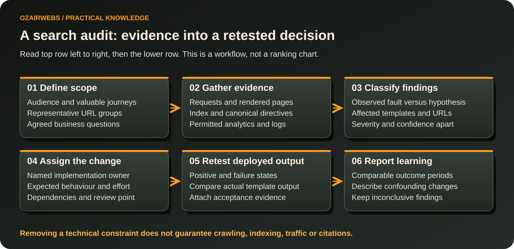

# SEO audit workflow: observation to verified fix

> **Review note:** Close the finding after the deployed output is retested, not when the task is merely marked complete.

*Original conceptual map. The text below explains each decision; no performance or citation outcome is asserted.*

An actionable audit explains what is wrong, how the evidence supports that conclusion and what would prove the repair. An exported tool report alone rarely establishes those three points. Use a controlled sample before widening a crawl, and document access and rate limits.

## Define scope and capture a baseline

Agree the public hosts, business objectives, important templates, languages and deployment constraints. Obtain only necessary access. Record an inventory and comparable search/analytics periods, separating branded demand from non-branded discovery where possible. Note seasonality, campaigns, migrations and measurement changes that could affect interpretation.

Inspect representative responses and rendered pages. Compare navigation, sitemap and content inventories. Check actual indexing observations when authorised access exists; a successful HTTP response is not an indexing verdict. Logs can clarify requested paths, but verify crawler identities before using them as evidence.

## Turn findings into decisions

For each finding record the affected surface, evidence, business consequence, hypothesis, implementation owner, effort and retest. Prioritise confirmed failures affecting important journeys. A missing title on a revenue-relevant category can deserve attention before an inconsequential warning on an obsolete page. Do not collapse certainty and severity into an unexplained score.

Distinguish technical remediation, editorial work and authority development. A canonical conflict needs different ownership from unclear purchasing information. Content briefs should specify intent, evidence, unanswered questions and what the page should help a visitor decide. Genuine digital PR involves relevant editorial interest and disclosures; purchased or mass-produced links should not be proposed as a shortcut.

## Validate implementation

Test on staging where possible, then verify the deployed output. Use representative positive, empty and failure states. Check redirects, index directives, canonical choices, translated alternatives, product facts and actual conversion paths. Close a finding only after the retest evidence is attached. Keep deferred issues with a reason and named dependency.

## Report learning

Describe deployed changes and comparable outcomes, including inconclusive results. Document what may have confounded the comparison. Search engines decide crawling, indexing and ranking; a repaired fault can remove a constraint without guaranteeing increased traffic.

The [reusable checklist](technical-seo-checklist.md) and [example finding register](../examples/README.md) support this workflow. Automation can classify or route findings, but an engineer should validate a template fault before a site-wide change. Store sensitive exports privately and publish only anonymised, permitted evidence.
